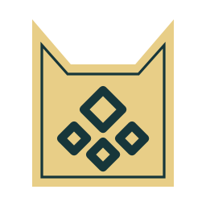
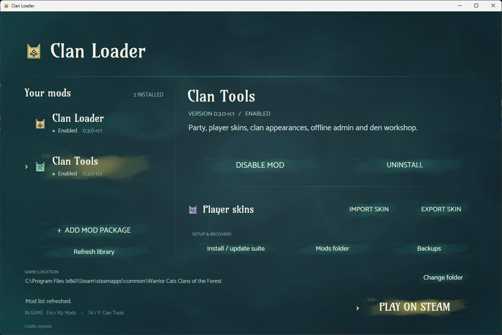
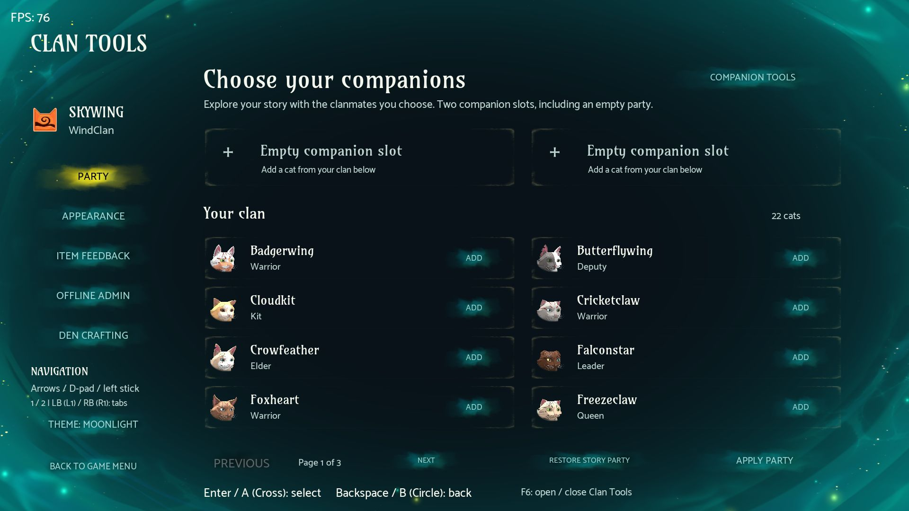
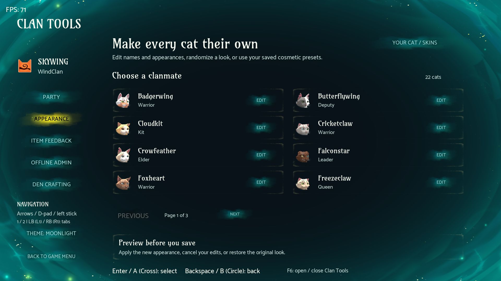
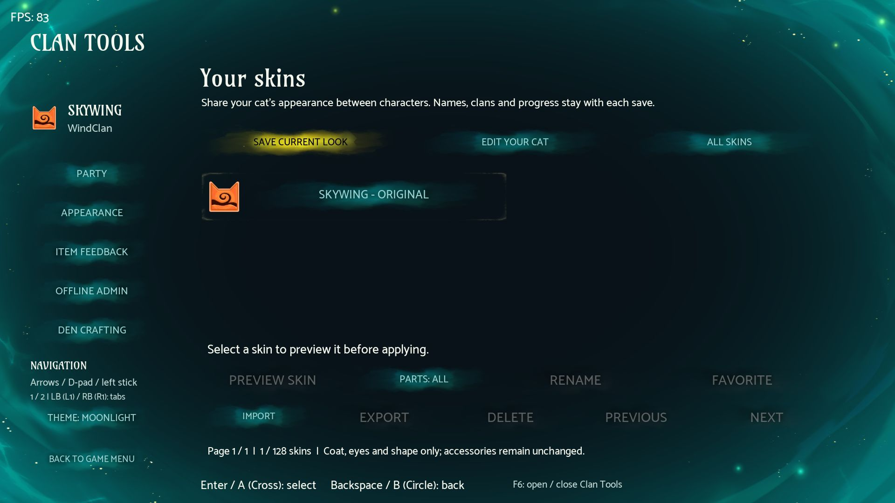
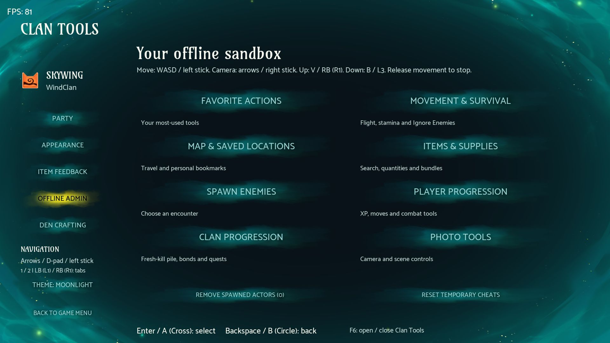
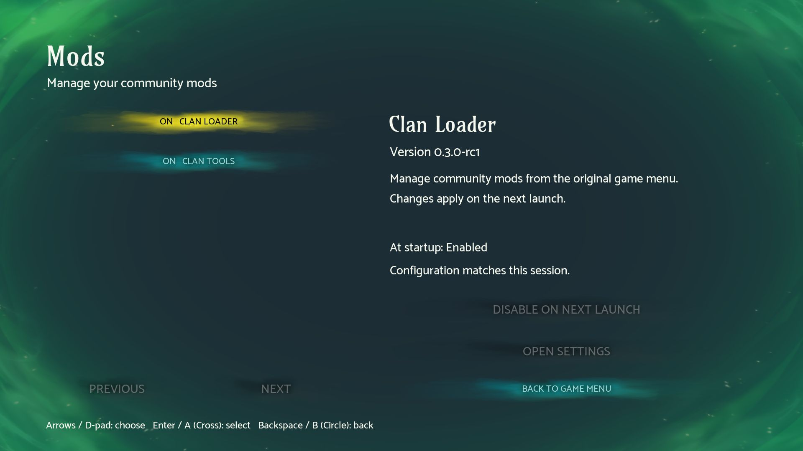
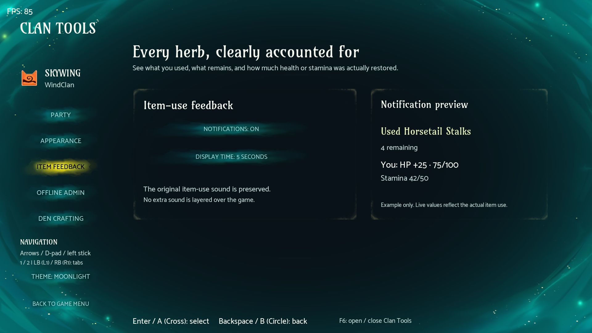
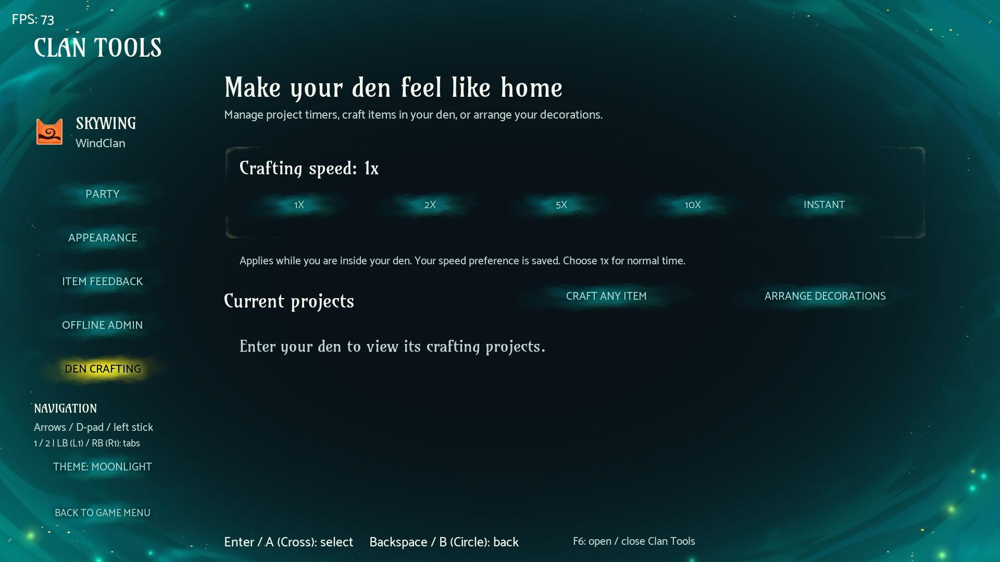

<p align="center"></p>

# Warrior Cats Clan Tools

Community mods and a mod manager for **Warrior Cats: Clans of the Forest**. Customize your clan, save your cat's looks, manage your party, and explore with offline tools through menus styled to match the game.

**Pull requests are welcome.** Bug fixes, new features, documentation improvements, and compatibility work are all welcome. See [CONTRIBUTING.md](CONTRIBUTING.md) to get started.

[Download the release candidate](https://github.com/kyotozx/warrior-cats-clan-tools/releases) · [Report a bug](https://github.com/kyotozx/warrior-cats-clan-tools/issues/new?template=bug_report.yml) · [Suggest a feature](https://github.com/kyotozx/warrior-cats-clan-tools/issues/new?template=feature_request.yml)



## In-game gallery

Actual screenshots from the supported game build. The menus reuse the game's fonts, portraits, buttons, and animated backgrounds.

| Party Manager | Clan appearance |
| --- | --- |
|  |  |

| Player skins | Offline Admin |
| --- | --- |
|  |  |

<details>
<summary>Native Mods menu, item feedback, and den crafting</summary>







</details>

## Performance and FPS

Graphics presets, saved custom configurations, the frame limiter and FPS counter now live in [Performance](https://github.com/kyotozx/warrior-cats-performance), a separate optional mod. It uses Clan Loader and does not require Clan Tools. Open it from the game menus with F9 / L3.

## Compatibility

| Requirement | Supported version |
| --- | --- |
| Platform | Windows x64, Steam |
| Game | Warrior Cats: Clans of the Forest |
| Steam app | `3960600` |
| Game build | `26184573` |
| Status | Release candidate |
| Gameplay tools | Offline campaigns |

The installer checks the game executable before applying changes. Other builds are not supported yet. This is an unofficial project with no affiliation with the game's developers or rights holders.

## Install

Use [Clan Loader rc11](https://github.com/kyotozx/warrior-cats-clan-tools/releases/tag/v0.3.0-rc11) for game patch 1.1. It includes the manual package import fixes and automatically handles the Windows download block on its theme DLL.

1. Download the Clan Loader ZIP for your game build from [Releases](https://github.com/kyotozx/warrior-cats-clan-tools/releases). Use this package, rather than GitHub's automatically generated source archives.
2. Save and close the game. Extract the entire ZIP to a writable folder.
3. Open `ClanLoader.exe`. Check the detected game folder, then select **Install / update suite**.
4. Start the game. Open **Mods** from the main or pause menu. In an offline campaign, open **Clan Tools** from pause.

The package includes the tested UE4SS runtime. Python and a separate mod loader download are not required. The external app handles packages, updates, removal, skin imports, and backups. The in-game menus provide the gameplay tools.

Game textures and fonts are loaded from your own installation. They are not included in this repository or the release package.

The loader checks GitHub for new Clan Loader, Clan Tools and Performance releases in the background. Choose **View update** to open the download page. Updates are installed manually; checking does not change your game or send saves.

## Troubleshooting

### Wrong clan or empty roster on another save

The published rc6 and rc7 packages can read the wrong character slot, causing mixed names, portraits or an empty roster. Restarting does not reliably resolve this. The rc8 update corrects the selected-character reader and passed local tests with two different campaigns, including switching between them without restarting. See [known bugs](KNOW-BUGS.md) for status. Reports with the affected save and your UE4SS.log are welcome.

After updating to rc9, set your party selections, party presets and custom display names again. Character-specific settings now follow the actual character, including when a deleted character's slot is reused. Older settings, original-appearance snapshots, den layouts and waypoints remain on disk but are not reapplied because their ownership is uncertain. Your game saves, shared appearance presets and saved skin library are preserved.

### Loader cannot load ThemeAssets.dll (0x80131515)

Windows can mark downloaded DLLs as blocked. Starting with rc11, the loader automatically removes that marker from its bundled `ThemeAssets.dll` before loading it. No manual DLL changes, administrator access or system-wide execution policy changes are needed.

If you see this error in an older copy, close it, extract the latest loader ZIP into a new folder and open `ClanLoader.exe` from that folder. Keep all extracted files together.

### Performance did not update with the suite

**Install / update suite** updates Clan Loader and Clan Tools from the downloaded bundle. Performance is separate: download its current ZIP and import it through **Add mod package** with the game closed. Existing Performance presets and settings are preserved.

## Controls

| Action | Keyboard | Controller |
| --- | --- | --- |
| Mods menu | F10 | R3 |
| Clan Tools from pause | F6 | Y / Triangle |
| Navigate | Arrow keys | D-pad / left stick |
| Select | Enter | A / Cross |
| Back | Backspace | B / Circle |
| Switch tool tabs | 1 / 2 | LB / RB |

On-screen hints explain tool-specific actions and reflect supported remaps. All mod interface text is in English.

## Features

| Tool | What it does |
| --- | --- |
| Party Manager | Choose up to two living clanmates, remove forced companions, save party presets, and restore the story party. |
| Exploration followers | Follow, stay, and regroup controls, nearby name/rank labels, smoother spacing, and independent idle timing. |
| Clan appearance | Use the native appearance editor, rotate and randomize cats, edit names, generate names, and save cosmetic presets. |
| Player skins | Save, preview, favorite, and share looks. Reuse a saved look in the original new-player creator without copying progression. |
| Item feedback | See consumption, remaining quantity, actual health/stamina changes, and hear feedback. |
| Offline Admin | Flight, noclip, speed, healing, invulnerability, item and enemy spawning, XP, move unlocks, damage controls, and infinite stamina. |
| Travel and exploration | Choose a destination on the original map, save waypoints, return to previous positions, and suppress ordinary enemy detection. |
| Clan upkeep | Fill or lock the fresh-kill pile, edit bonds, and complete quests. |
| Den crafting | Accelerate crafting timers or finish projects. Craft supported decorations and inventory items with a free option. |
| Den layout and photos | Preview decoration changes, use layout tools, adjust photo settings, and choose native day/night lighting presets. |
| Settings | Edit keyboard/controller bindings with conflict detection and reset controls. |

Some actions change saved progression. Read the confirmation shown by the tool and keep backups. See the [full feature guide](mods/ClanTools/release/README.txt) and [validation notes](mods/ClanTools/release/VALIDATION.txt) for tested behavior and limitations. Day/night is a lighting override, not a simulated clock or weather system. Map travel needs valid loaded ground. Story battles are not disabled by Ignore Enemies.

## Mods and packages

Clan Loader adds package management and a native Mods menu on top of UE4SS. It checks package paths, declared files, hashes, dependencies, and game-build compatibility. It does not sandbox executable mod code.

Changes to enabled mods take effect on the next launch. The current release has no automatic updater, online mod catalog, or Steam Workshop integration. Compatibility with other community managers has not been established.

Want to make a mod? Start with the [package format](mods/ClanLoader/DEVELOPERS.txt) and the [architecture guide](docs/ARCHITECTURE.md).

## Project layout

```text
mods/
  ClanLoader/
    Scripts/       Native in-game Mods menu
    manager/       External Windows manager and original emblems
    tests/         Loader and package tests
  ClanTools/
    Scripts/       Gameplay features and native menu integration
    native/        Build-specific C bridges
    data/          Static interoperability catalogs
    release/       Installer, package rules, feature and validation notes
    tests/         Lua, native, and installer tests
  ClanParty/
    native/        Shared party bridge retained under its original path
scripts/           Build, audit, and test entry points
docs/              Development and project documentation
```

The loader and tools share one repository so related changes can be reviewed together. They remain separate installable packages. Individual Clan Tools features currently share runtime state and native UI code, so they are modules within the suite, not separate installable mods.

## Development and contributions

Read [BUILDING.md](docs/BUILDING.md) for prerequisites and build commands. Read [CONTRIBUTING.md](CONTRIBUTING.md) before opening a PR. You can help with reproducible bug reports even without a development setup.

## Credits and license

**Credits: kyotozx**

Original project code is available under the [MIT License](LICENSE). Third-party components keep their own licenses. UE4SS is MIT licensed. The separate ooz decompression helper is GPL-3.0-or-later and includes its source and notices. See [THIRD-PARTY-NOTICES.md](THIRD-PARTY-NOTICES.md).

Game names, assets, and related intellectual property belong to their respective rights holders. No permission to redistribute game assets is granted by this project's license.
